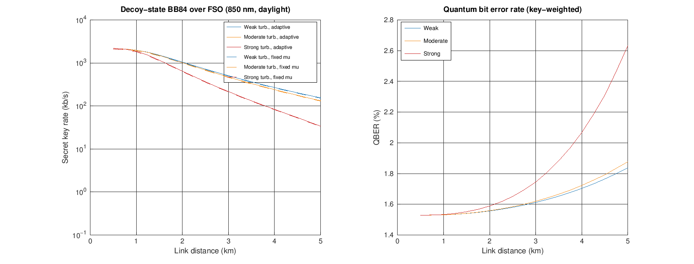
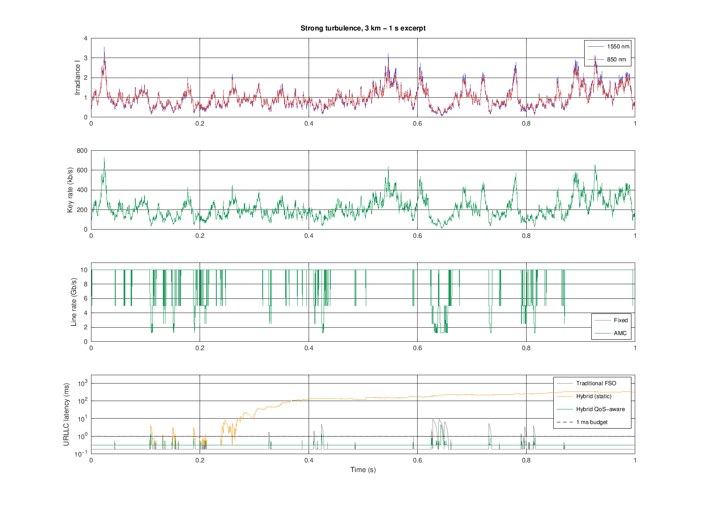

# Hybrid Classical–Quantum FSO Links with QoS-Aware QKD in 5G Network Slicing

MATLAB simulation of a 5G free-space-optical (FSO) backhaul hop that carries classical data (1550 nm) and
decoy-state BB84 quantum key distribution (850 nm) over the same turbulent path. Secret key is generated
at the physical layer and handed out to three 5G slices (URLLC, eMBB, mMTC) by a QoS-aware key scheduler.

Runs in base MATLAB (no toolboxes) and in GNU Octave. All results here were produced with Octave 8.4;
I could not run it in MATLAB itself, so expect to fix a small compatibility issue if one turns up.

```
>> main                       % full study, ~11 min in Octave (writes results/ + figures)
>> run_sanity_checks          % tests/ – 13 self-tests (fading statistics, key-rate monotonicity, scheduler conservation)
```

## What is modelled

| Block | Model | File |
|---|---|---|
| Turbulence | Gamma-Gamma irradiance fading with aperture averaging, Cn² = 1e-15 / 1e-14 / 1e-13 (weak / moderate / strong); temporally correlated (Gaussian copula, τ = 2 ms and 10 ms); turbulence-induced beam broadening; Kim visibility model | `gg_params`, `gg_fading`, `beam_spread`, `atm_atten` |
| Quantum channel | Decoy-state BB84 (signal + decoy + vacuum, Ma et al. bounds), 850 nm Si-SPAD, 100 MHz, daylight background, dark counts; asymptotic key rate; fading-adaptive signal intensity vs fixed μ = 0.5 | `qkd_decoy_rate`, `quantum_budget`, `build_qkd_lut` |
| Classical channel | 1550 nm IM/DD OOK, Q-factor and BER under fading, hard-decision FEC cliff, 4-rate adaptive modulation (1.25–10 Gb/s) driven by delayed channel feedback | `classical_budget`, `run_scheme` |
| Slices | URLLC (50 Mb/s, 1 ms budget), eMBB (3 Gb/s, 10 ms), mMTC (300 Mb/s, 100 ms); bursty traffic and bursty key requests; finite queues | `config_params`, `gen_environment` |
| Key scheduler | Static equal split **vs** QoS-aware 3-stage allocation (key-assured slices first, then priority-weighted water-filling to buffer targets, then top-up of spare headroom) | `key_scheduler` |
| Classical scheduler | Slice-blind max-min fair **vs** URLLC strict priority + weighted fair share; QKD post-processing traffic taken from the link first | `class_scheduler` |
| Latency | Virtual-delay method on cumulative curves: end-to-end = propagation + framing + queueing + wait for a fresh key | `virtual_delay` |

Three schemes are compared on identical channel and traffic realisations (common random numbers):
**Traditional FSO** (fixed 10 Gb/s, no QKD), **Hybrid (static)** (QKD with fixed μ, equal key split, fixed rate), and
**Hybrid QoS-aware** (adaptive μ, QoS key scheduler, adaptive modulation, priority scheduling).

Default scenario: 3 km hop, daylight sky radiance 5 mW m⁻² sr⁻¹ nm⁻¹, 8 s per run, 3 seeds per point (`config_params.m`).

## Results (3 km, daylight)

| | Weak | Moderate | Strong |
|---|---|---|---|
| Secure key rate, Hybrid QoS-aware (static μ in brackets) | 505 (494) kb/s | 466 (455) kb/s | 215 (211) kb/s |
| QBER | 1.6 % | 1.6 % | 1.7 % |
| URLLC SLA met (latency < 1 ms, no loss): Traditional / Hybrid static / **Hybrid QoS** | 100 / 100 / 100 % | 98.2 / 97.8 / **99.99 %** | 93.0 / 2.8 / **99.4 %** |
| URLLC P99 end-to-end latency: Traditional / static / **QoS** | 0.18 / 0.31 / 0.31 ms | 2.2 / 2.3 / **0.31 ms** | 9.1 / 2240 / **0.64 ms** |
| eMBB key demand served: static / **QoS** | 68 / **100 %** | 63 / **100 %** | 31 / 29 % |
| Link frame-loss time: Traditional / **QoS** | 0 / 0 % | 4.1 / **0.8 %** | 11.1 / **2.9 %** |
| Delivered/offered traffic, 5th pct over 10 ms: Traditional / **QoS** | 100 / 100 % | 99.4 / **100 %** | 64 / **89 %** |

Figures are in `results/`; full tables in `results/summary_slices.csv` and `results/summary_links.csv`.




### What the numbers do and do not show

- **Secure key rate.** A traditional FSO link produces no information-theoretic key, so the comparison there is
  0 vs 215–505 kb/s. Between the two hybrid schemes the rate gain from fading-adaptive intensity is small,
  about 2 %. The large gain comes from the allocation: the static split wastes 8–34 % of the generated key in
  full buffers while eMBB starves, and the QoS scheduler wastes none.
- **Throughput stability.** Mean goodput is the same for all schemes (8.9 Gb/s in strong turbulence). Adaptive
  modulation does not raise the mean. It cuts frame-loss time and keeps delivered traffic closer to offered
  load in bad fades (5th percentile 64 % → 89 %).
- **Latency / reliability.** The QoS-aware scheme meets URLLC's 1 ms budget in 99.4–100 % of 0.25 ms slots. URLLC's
  usual 99.999 % target cannot be resolved with 8 s × 3 seeds. Strong turbulence leaves a residual of deep fades
  that rate adaptation alone cannot remove (it would need diversity or an RF fallback).
- **Strong turbulence is key-limited.** With ~215 kb/s supply against ~400 kb/s demand, eMBB is starved under both
  hybrid schemes (≈ 30 % served) because the QoS scheduler protects URLLC and mMTC first. The demand sweep
  (`fig7`) shows the same trade-off at moderate turbulence: past ~1.5× nominal demand eMBB loses key before URLLC does.
- **Ordering trade-off.** A hybrid link has higher absolute latency than the plain link when key supply is short,
  because a request waits for fresh key. Mismanaged (static) key allocation makes that very visible (2.2 s URLLC P99 in strong turbulence).

### Modelling assumptions worth knowing

Asymptotic (infinite-block) key rate and a fixed 1.16 error-correction inefficiency, no finite-size penalty;
turbulence enters through Gamma-Gamma scintillation plus long-term beam broadening, with no explicit beam wander
or pointing model (a 150 µrad effective divergence stands in for pointing error); classical frame loss is a
FEC-threshold cliff model rather than a coded simulation; slices share one wavelength channel in a fluid-queue model
(no packet-level 5G scheduler); parameter values are plausible mid-range numbers, not a specific hardware product.
Change them in `config_params.m`.

## Layout
```
main.m                    run everything
src/config_params.m       every parameter
src/gen_environment.m     fading + traffic + key demand for one seed
src/run_scheme.m          one scheme on one environment -> metrics
src/key_scheduler.m  src/class_scheduler.m
src/run_experiments.m     distance sweeps, slice study, key-demand sweep
src/make_figures.m  src/print_report.m  src/write_summary_csv.m
tests/run_sanity_checks.m
results/                  figures, CSV tables, results.mat
```

## Suggested resume wording (matches what this code actually shows)
> Built a MATLAB simulator of a hybrid FSO backhaul combining 1550 nm classical transmission with decoy-state BB84 QKD (850 nm) for 5G slicing; modelled Gamma-Gamma turbulence at three Cn² levels and URLLC/eMBB/mMTC slices. A QoS-aware key scheduler with adaptive modulation kept URLLC within its 1 ms budget in 99.4–100 % of slots (93 % for plain FSO in strong turbulence) at 215–505 kb/s secure key rate and ~1.6 % QBER over a 3 km link.
